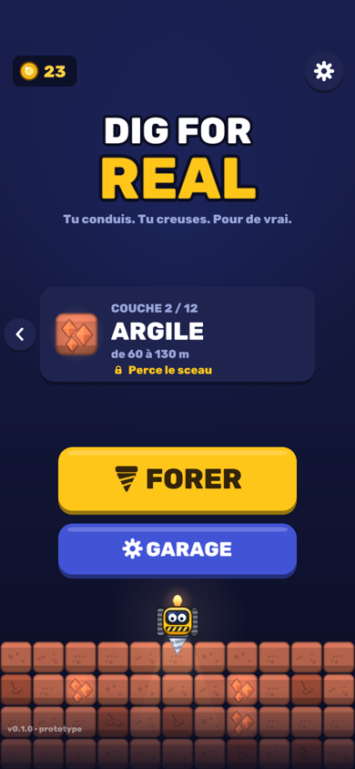
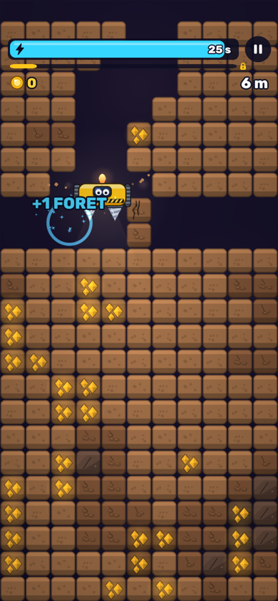
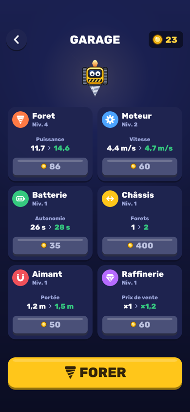

# Dig For Real — créer un vrai jeu à partir d'une publicité mensongère

Projet : identifier un mini-jeu que des publicités de jeux mobiles promettent sans le livrer, en faire un vrai jeu iOS et Android, et vérifier s'il peut devenir rentable — en appliquant la méthode du développeur indépendant Dan Lespect à un concept différent du sien.

**Concept retenu** : un engin de chantier qu'on dirige d'un doigt, qui creuse, ramasse du minerai, le vend et devient énorme. Nom provisoire : *Dig For Real*.

  

## Où en est le projet (12 novembre 2026)

| Livrable | État |
|---|---|
| Étude de la méthode de Dan Lespect | Faite, à partir d'extraits de recherche ; la vidéo de référence n'a pas pu être visionnée |
| Catalogue de publicités | 28 fiches sourcées |
| Analyse de la concurrence | Faite sur cinq familles de jeux |
| Classement des concepts et recommandation | Faits |
| Cahier des charges | Fait |
| Prototype | **Jouable et testé hors Unity ; jamais encore lancé dans Unity ni sur un téléphone** |
| Plan de tests et de commercialisation | Faits ; aucun test joueur réalisé |

Le détail, les prochaines étapes et les points bloquants sont dans [`ROADMAP.md`](ROADMAP.md).

## Par où commencer

1. **Voir le jeu** : les captures de [`game/docs/captures/`](game/docs/captures/), puis ouvrir le projet dans Unity en suivant [`game/README.md`](game/README.md).
2. **Comprendre le choix du concept** : [`game-design/01-selection-concept.md`](game-design/01-selection-concept.md).
3. **Régulariser le cadre** : faire valider [`docs/fiche-intention.md`](docs/fiche-intention.md) (voir « Cadre de l'organisation » plus bas).
4. **Tester avec des joueurs** : [`testing/01-protocole-tests-joueurs.md`](testing/01-protocole-tests-joueurs.md).

## Contenu du dépôt

| Dossier | Contenu |
|---|---|
| [`research/`](research/) | Étude du cas Dan Lespect (chiffres classés par fiabilité) et synthèse du marché |
| [`ads-catalog/`](ads-catalog/) | Les 28 publicités et mécaniques étudiées, avec sources et niveau de preuve |
| [`competitors/`](competitors/) | Jeux existants par famille, critiques des joueurs, risques de propriété intellectuelle |
| [`game-design/`](game-design/) | Sélection du concept, cahier des charges, architecture technique |
| [`game/`](game/) | Projet Unity du prototype, banc d'essai et tests hors Unity |
| [`testing/`](testing/) | Protocole, questionnaires, mesures et seuils, plan de diffusion vidéo, résultats disponibles |
| [`launch/`](launch/) | Règles des stores, fiches produit, confidentialité, monétisation et scénarios économiques |
| [`docs/`](docs/) | Fiche d'intention et registre des exceptions au cadre de l'organisation |

## Reprendre le développement

Avec Unity : voir [`game/README.md`](game/README.md).

Sans Unity (SDK .NET 10) : la commande suivante compile le jeu, lance les tests et vérifie la couche Unity.

```bash
bash game/Tools/verifier.sh
```

Tous les réglages du jeu sont dans `game/Assets/Game/Core/Game/Balance.cs`. L'architecture est décrite dans [`game-design/03-architecture-technique.md`](game-design/03-architecture-technique.md).

## Comment lire les documents de recherche

- Chaque affirmation est étiquetée : **fait** (sourcé), **déclaratif** (dit par l'intéressé, non audité), **estimation** (chiffre d'un tiers), **hypothèse** (raisonnement).
- Les recherches ont été menées sans pouvoir ouvrir la plupart des sites : elles reposent sur des extraits de résultats de recherche. Chaque document liste ce qui n'a pas pu être consulté et comment le vérifier.
- Les chiffres de marché du dossier `launch/` (eCPM, rétention, coût d'installation) sont des repères non sourcés : à confirmer avant toute décision.

## Cadre de l'organisation

Ce projet est soumis au socle de règles de l'organisation du porteur de projet.

| Point | Situation |
|---|---|
| Fiche d'intention | Rédigée, **non validée**. Le prototype a été codé avant validation, à la demande du builder : exception EX-001 dans [`docs/exception.md`](docs/exception.md) |
| Données personnelles | Aucune dans le prototype : ni compte, ni réseau, ni base de données |
| Publication, hébergement externe, SDK de publicité ou de statistiques | **Non engagés.** Chacun demande une décision explicite et une entrée dans le registre des exceptions |
| Transfert de données hors de l'Union européenne | Passe d'abord par la DPO, sans exception possible |
| Dépenses, comptes payants | Aucun engagé |

## Licences

- Code du jeu et documents : à définir par le porteur de projet.
- Police Rubik : SIL Open Font License 1.1 (fichier joint dans `game/Assets/Game/Resources/Fonts/`).
